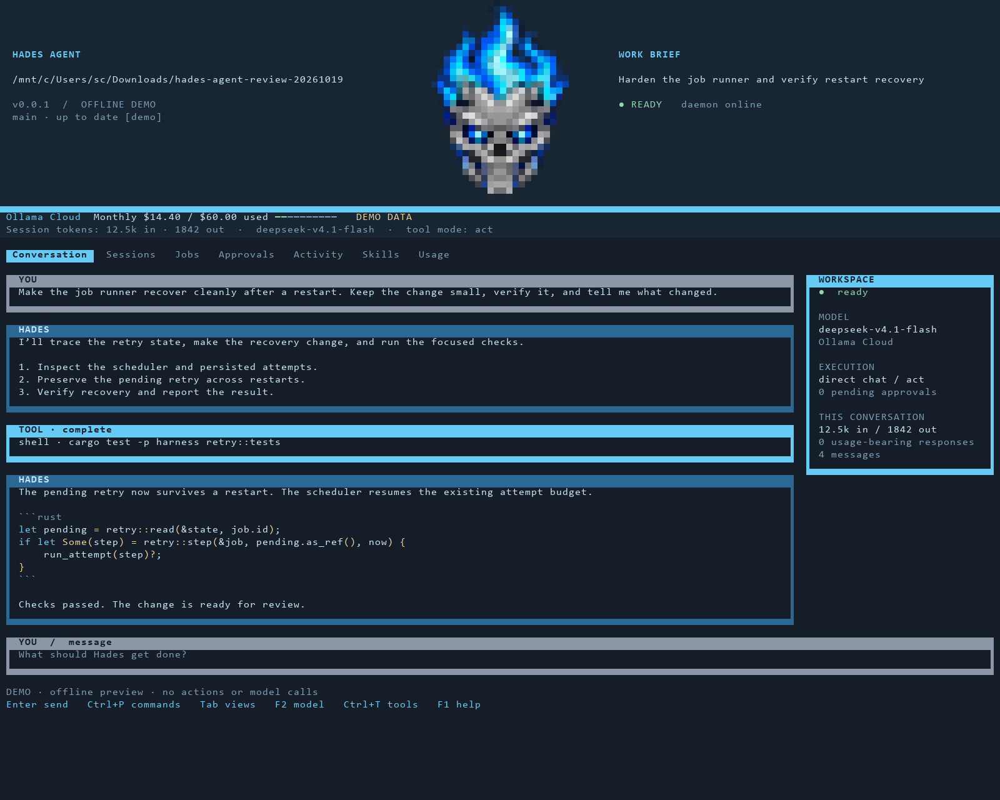

<p align="center">
  
</p>

<h1 align="center">Hades Agent</h1>

<p align="center">
  <strong>A governed agent runtime in Rust.</strong><br>
  One binary. Four crates. Its own state.
</p>

<p align="center">
  <a href="https://www.rust-lang.org/"></a>
  
  
  
  
</p>

Hades runs a conversation, a scheduled job, or a piece of long-horizon work with a check and an attempt
budget. The point is not a plausible answer. The point is a result you can inspect afterwards: what ran,
what was allowed, what was refused, what changed, and why the run stopped.

It is a single-user runtime built around one rule:

> **A rule that can be a type is a type.**

A read job is not asked to avoid writing. It is handed no tool that writes. A memory change cannot happen
without a write permit. A refusal is a recorded decision, not a sentence in a prompt.

## Lineage and inspirations

Hades is a distilled harness, not a new kind of agent. Its direct ancestor is
[Hermes Agent](https://github.com/NousResearch/hermes-agent) by Nous Research, released under the MIT
License. Hades began as a fork of that harness and was then rebuilt as a Rust runtime. The tool loop, the
skill model, the session shape, the gateway and the memory seam are all distillations of ideas proved
there. The upstream Python tree is not shipped in this checkout.

The interaction model also owes a debt to the terminal coding agents that made plan, act, check and retry
feel normal, especially [Claude Code](https://github.com/anthropics/claude-code) and the
[Codex CLI](https://github.com/openai/codex). Hades does not wrap either one. The loop is local.

The isolation model builds on [Linux Landlock](https://landlock.io/). The memory record builds on
[SQLite FTS5](https://www.sqlite.org/fts5.html). Those are foundations, not branding.

If you want the original harness this distills, start with Hermes Agent. Hades is the smaller, stricter
reading of it: the same shape, with the loop, the permissions and the evidence trail made explicit.

---

## At a glance

| | |
|---|---|
| **Version** | 0.0.20 |
| **Language** | Rust 2024 |
| **Shape** | One `hades` binary, four crates |
| **State** | `~/.hades`: config, sessions, memory, jobs, approvals, activity, taste |
| **Work profiles** | `survey`, `fix`, `sweep`, `verify`, `record` |
| **Isolation** | Landlock cage plus a deterministic safety floor |
| **Memory** | SQLite record with a markdown export and FTS5 recall |
| **Interfaces** | Native TUI, CLI, ACP over stdio, HTTP read/control surface, Telegram gateway |
| **Browser** | Native Chrome DevTools Protocol client over Chromium's pipe |
| **Tests** | 984 passing, 13 ignored live tests |

---

## What 0.0.20 adds

This release makes a pack fit into a home, and keeps a record of what it changed.

- **`hades pack apply` installs only the rows a person accepted.** The decision file names a kind,
  identity and one of `install`, `replace` or `skip`; a row outside the plan is refused. Skills land
  under `skills/proposed/` unless `--activate` names them active. A conflict may be replaced, and the
  old live path is moved to `packs/replaced/<pack>/<time>/` first. A skill installed as a proposal is
  not loaded as active work.
- **Every installed item lands in a catalog.** `packs/catalog.jsonl` records the pack, version, pack
  digest, item digest, the live digest at install time, the live path and the content path. The content
  is a copy under `packs/<id>/<version>/`; nothing is symlinked. A second apply of the same version is
  refused before it writes.
- **`hades pack uninstall` removes what the pack owns.** It removes a live copy only when its digest
  still matches, so a skill edited after install is kept and named in the receipt. A promoted skill is
  kept as active. A case is retired in its ledger rather than left as a broken directory. Shared
  content is removed only when no remaining row references it, and an uninstall event is appended.
- **`hades pack adapt` makes a local draft.** One model call reads the pack text, the local catalog
  brief and the license. It returns rewritten text, a change list and any unresolved conflicts; the
  result is shown as a diff and written only with `--accept`. Derivatives must be allowed. The draft
  carries `contract: TODO`, empty regression and holdout lists, so it cannot pass as evidence until a
  person fills them in.
- **`hades pack merge` composes a draft, never an overwrite.** The incoming skill and the installed one
  are both read, both contracts and the conflicts are recorded with provenance, and the result is a
  proposal. It is skill-only in this release; harness merge is refused by name.
- **The limits are explicit.** Atomicity is per item, not per pack: a failure after earlier rows have
  landed leaves those rows and names the failure. Trust (digest pinning and unsigned-pack refusal) is
  0.1.0 work; a pack is still unsigned and the reader says so.

## What 0.0.19 adds

This release gives a result a container that can leave the machine without losing its evidence.

- **A `.hadepack` is a deterministic tar.gz with a strict manifest.** `pack.json` names the pack, its
  version and license, the Hades range it needs, the roles and tools it asks for, and every skill,
  harness and case under `files/`. `SHA256SUMS` covers each file. The writer sets every directory to
  0755, fixes mtimes, owners and ordering, compresses with `gzip -n`, and records file modes, so the same
  inputs produce the same bytes. A reader rejects an unsafe path, a duplicate name, a symlink or special
  entry, an unknown key, a `code: true` capability, and an archive over the size caps before trusting it.
- **`hades pack export`** writes one. It takes `--skill`, `--profile` and `--case` selectors, records the
  current Hades range, and never reads the live Hermes home. A directory skill is copied as a directory;
  a flat skill becomes `files/skills/<name>/SKILL.md`; a case carries its pinned tree and `case.json`.
- **`hades pack inspect`** reads the manifest, every item, uncompressed bytes, archive hash, signature
  status and the network/vault warnings. It asks no model and changes no state.
- **`hades pack plan`** classifies each item against the live catalog as `new`, `duplicate`, `conflict`,
  `redundant` or `incompatible`. Duplicate and conflict use identity plus content digest; redundancy
  uses 5-gram Jaccard at 0.60 and prints the shared shingles so the heuristic is reviewable. Nothing is
  installed yet: applying a plan is 0.0.20.

## What 0.0.18 adds

This release closes the last research limits.

- **A social post can supply the paper it links to.** When a search hit is a social URL, Hades reads the post as raw
  markup, skips navigation and shortener links, resolves the first link that leaves the platform, fetches that
  artifact, and stores it as the source. The report shows the artifact URL with `via` the post; `run.json` and
  `report.json` carry both `url` and `artifact_url`. A post with no visible artifact is a named gate failure, never
  a source by itself, and the artifact fetch is charged to the same budget.
- **`--entailment` audits the quote against the claim.** For each verified claim, one capped model call labels the
  link `supported`, `partial` or `unsupported` and gives a short reason. Labels appear under the claim and in
  `entailments`; token use is on its own ledger line. This is advisory. The byte check still decides provenance.
- **`--workers 1..8` fetches a candidate batch in parallel.** Results are processed in candidate order, so
  `--workers 1` reproduces the serial run exactly. Each fetch still passes the same URL, private-address and
  deadline gates; the budget is checked before a batch starts.

## What 0.0.17 adds

This release closes the limits named at 0.0.16. The library reads more kinds of documents, and research
records a disagreement between sources instead of averaging it away.

### The library reads structure, not just bytes

- **A scanned PDF falls back to OCR.** Hades still tries `pdftotext` first. When the text layer is empty it
  rasterizes each page with `pdftoppm` at 300 dpi and runs `tesseract`; the page marker records `ocr=1`, and
  the entry carries the tag `ocr` in `library list`, `library show` and `library list --json`. Page and byte
  caps stop a runaway scan. `--ocr-lang` selects the language pack, and the scratch directory is removed on
  every exit path.
- **An EPUB is read in spine order.** The extractor follows `META-INF/container.xml` to the OPF package,
  then the manifest and spine, instead of trusting the zip listing. EPUB3 `nav` and EPUB2 `ncx` supply the
  table of contents; footnote asides stay as footnote text; image `alt` text is folded into the body.
- **LaTeX math becomes readable Markdown math.** `\[...\]`, `\(...\)`, `equation`, `align` and `gather`
  convert to display and inline math, and escaped dollars survive. This is still a reading view, not
  rendered math.

### Research can record a dispute

- **`--judge on|off`** (default on) compares claims from different sources on the same subquestion, in
  capped pairs. A contradictory pair is written to `## Cross-source disputes` in the report and to
  `disputes` in `run.json` and `report.json`. Both quotes are still byte-verified; the section records a
  conflict, not a verdict.
- **`--judge off`** keeps the old behavior. Judge token counts are recorded separately on the usage ledger,
  and older runs still load because every new field is serde-defaulted.
- **`hades research bench <questions.json> --grades <grades.json>`** compares key-term coverage with a human
  verdict. The bench prints `grades: N pass, N partial, N fail` and
  `coverage predicted N/M grades; this is a calibration, not truth`. A grade that names a question the
  bench does not have is a named error, not a silent skip.
- **The parent-log race test waits 30 seconds**, not 10, so a loaded full-suite run cannot turn endpoint
  latency into a false log-collision failure.

## What 0.0.16 adds

### The offline library

Hades can read a local shelf with no network.

- **Every install starts empty.** `hades library list` on a fresh state prints that the shelf is empty. There is no seed corpus, no sample paper, no placeholder entry. A document exists only after you add it.
- **`hades library add <file-or-directory>`** imports PDF, EPUB, LaTeX, Markdown, plain text and reStructuredText. Directories are walked. The original is kept on disk and the readable text is extracted into the shelf.
- **PDF text comes from `pdftotext`** (poppler), not a browser or a model. EPUB is unpacked with a member cap and refuses path traversal. LaTeX is converted to Markdown by a small deterministic reader, so a paper stored as source remains readable without a TeX installation.
- **The index is SQLite with FTS5.** `hades library search <words>` returns ranked passages; `hades library read <id>` prints the stored text; `hades library verify` re-reads every original and recomputes its hash.
- **`hades research <question> --offline`** plans, searches the shelf, fetches a library document and runs the same byte-verified quote check. The report records `mode "offline library"`.
- **The shelf is per state.** A process started with `--state X` cannot read `--state Y`'s books. The agent's `library` tool uses the same resolved shelf.
- **`--strict` upgrades an off-question claim from a warning to a failed check.** The normal check still exits 0 so an honest report with a flagged claim remains inspectable.

### Research depth

- **A structural relevance gate.** Each extracted claim is compared with its subquestion on distinctive terms. A claim that only matches the source's general subject is marked `off-question`, kept in the report under its own heading, and counted. It is never silently promoted into findings.
- **Fan-out is deduplicated and ranked.** Search hits are de-duplicated by normalized URL; primary documents are fetched before secondary pages, and social posts last.
- **Contradictions are first-class evidence.** An extractor may return a `contradicts` quote. The quote goes through the same byte check and appears in a `## Disputed` section instead of being averaged away.
- **A claim can be revised in place.** When a later source supports the same normalized claim with a new quote, the old text and support are kept in `history`; the report marks the claim as revised.
- **One retry on a bad quote.** If every draft from a source fails the byte check, the extractor is called once more with the mismatch as a hint. A second failure is recorded, not repeated.
- **`hades research bench <questions.json>`** runs a question set and reports published, claims, verified quotes, off-question count, sources, wall time, tokens and key-term coverage. Coverage is a reading aid, not a truth score.
- **`hades research file <run-id> --topic <category/topic>`** files a published, strict-green report as a Mneme research note with provenance and a `hades://research/<id>` source link.

The check proves provenance, not truth. The relevance gate catches a claim that is about the wrong subject, but it cannot prove that a correctly quoted sentence is representative, current or complete.

## What 0.0.15 adds

Research is an evidence-first run, not a chat that summarizes links.

- **`hades research <question>`** plans subquestions, searches, fetches, extracts and checks. Each worker gets one subquestion and one source; the run owns the state, so nothing depends on a growing conversation.
- **Every published claim carries a byte-verified quote.** `report.md` and `report.json` cite claims, and `hades research check <run-id>` re-reads the stored canonical text and compares the byte range. Exit 0 is green, 1 is a bad quote or missing citation, 2 is an unreadable source.
- **A run is a directory, not a transcript.** `run.json`, `assignments.jsonl`, `evidence.jsonl`, `failures.jsonl`, `sources/`, `report.md` and `report.json` live under `<state>/research/<run-id>/`. `hades research list` and `show` read it without asking a model.
- **The source gate refuses snippets and empty pages.** A source needs an HTTP URL, a body of at least 400 characters and a hash; a search snippet is never evidence.
- **`hades note research`** is now the vault-note verb. `hades note topic|project|product` are the same creation verbs, and the old top-level `topic`, `project` and `product` names remain aliases.
- **The HTML parser drops code before prose.** Script, style, noscript, template, SVG and iframe bodies are removed before tags, so a JavaScript-heavy page is not mistaken for a wall of evidence.
- **Search falls back when the local result set is blind.** If SearXNG cannot match two query terms, Hades reads DuckDuckGo's HTML results through Jina Reader rather than treating a single-token match as a source.

The check proves provenance, not truth. A quote can be real while the claim around it overgeneralizes; the report says so, and the extractor prompt now requires platform, driver, version and condition qualifiers to survive into the claim.

## What 0.0.14 adds

- **`config.json` can set a model per profile.** `profile_models` maps a shipped profile id to a preset; a profile with no entry inherits the config's `model`. An unknown id or preset is refused when the config is read, with the valid names in the message.
- **`hades route` prints the effective model**, including a `profile_models` override, so the choice is visible without starting a run.

## What 0.0.13 adds

- **Profiles can name a model, and inherit one when they do not.** `--model` still wins, then `profile_models.<id>` from `config.json`, then the profile's own setting, then the config's model. No shipped profile pins a model, so `verify` no longer asks for a preset this build does not ship.
- **The per-profile setting is validated when the config is read.** An unknown profile id or an unknown preset is refused by name, not silently ignored.
- **`hades profiles` and `hades route` say `inherit`** where a profile has no model of its own.

## What 0.0.12 adds

The limits left by 0.0.11 are closed, or written down where they are decisions.

- **An import is one transaction.** A failure after the first note rolls back every row it wrote, including the exported hash. The success path and the rollback path each have a test.
- **`hades audit --refresh`** imports the config's vault, refreshes `INDEX.md` and audits what is on disk. It is refused with `--vault`, where the import already happens on a throwaway record.
- **The clean-home acceptance script names six areas** and probes one creation verb, so the packaged install is checked against the vault the binary actually writes.
- **The residual limits have a ledger** in `HADES.md`: the TUI is a chat surface, Discord is deferred, the network is per role, WEFT stays read-only, and `skills report` does not estimate unmeasured numbers.

## What 0.0.11 adds

The vault can be built from the command line, and its links are resolved rather than declared.

- **Four creation verbs.** `hades topic <category> <name...> [--parent <topic>]`, `hades research <topic> <title>` (now `hades note research`; the top-level name is the engine), `hades project <name> [--topic <topic>] [--research <ref>...]`, and `hades product <name> --from <project>` write through `Vault`, so the CLI cannot author a note the store would refuse. Each refreshes `INDEX.md`.
- **A reference resolves to one note.** `research: [...]` and `from_project:` accept the full record path (`technical/ai-inference/kv-cache/kv-cache-at-32k`), the slug below its area (`kv-cache-at-32k`), or a bare trailing name (`kv-cache-at-32k`). A bare name two notes share is refused as ambiguous instead of guessing.
- **A dangling link is a finding, not a crash.** `hades audit` reports `dangling_research` and `dangling_project` with the missing name and the note that named it. `hades audit --vault` imports leniently for exactly this reason; `hades mneme import` stays strict.
- **An import reads the whole tree before it writes a row.** A tree that would leave an unresolvable reference is refused with zero rows written, including when the research note sorts after the project that names it.
- **Upgrading is a command.** `hades mneme upgrade [--retire-old]` writes the six-area tree, and with `--retire-old` moves the stale `40 Topics` folder to `mneme-archive/` rather than deleting it. Schema v3 adds the CHECK constraints the v1 rebuild dropped and files a legacy flat topic under `general`.
- **Outbox is explicitly inert.** The index says nothing reads it, and recall skips both Outbox and Inbox; a message left there cannot become context by accident.

## What 0.0.10 adds

The vault is a clone of WEFT, generic and empty, with marking posts a fresh agent can navigate.

- **Six areas.** `00 Inbox`, `10 Outbox` (for work that leaves the machine and, later, messages for other agents), `20 Research`, `30 Projects`, `40 Products`, `50 Topics`.
- **Topics are a tree.** The 26 categories are fixed from Foxforge's topic types, written to `TAXONOMY.md`; a topic is general (`technical/ai-inference`) and narrower things nest beneath it (`.../kv-cache`) instead of becoming a second topic for the same ethos.
- **The rules are structural.** Every research note, project and product names a topic; a durable project names its research; a product names the project it came from and is `active`, `closed`, `inactive` or `frozen`. Both the SQLite store and the file vault refuse a note that breaks a rule.
- **A fresh install reads as empty.** `hades init` seeds one `status: marker` note per area, and markers are excluded from the index, the audit counts and recall.
- **The index is a view.** `INDEX.md` groups topics by category, research by topic, and shows each project's research count and each product's origin; `mneme import` refreshes it so a vault cannot audit correctly and read as empty.
- **The record migrates.** Schema v2 rebuilds the note table for Products and nested slugs, keeps every row, tag and hash, and backfills each note's primary topic from its first tag.

## What 0.0.9 adds

The learning loop: a failed run becomes a dataset, a fix is measured against what came before, and a
procedure has to say what it is for before it can be loaded.

- **A failure becomes a case.** A giving-up run pins its starting tree, the goal, the oracle, the policy,
  model and the full ceiling it failed under. `hades cases` lists them, `hades case <id>` prints one,
  `hades case forget <id>` retires the tree and keeps the line. A case is a task, not a transcript: the
  copy is atomic, a deduplicated record appends `seen` rather than a second tree, and a tree past the
  snapshot limit is declined with the reason instead of being stored half-written.
- **`hades eval` replays the corpus.** A green start is `stale` with no model call; a red one re-runs the
  goal under the case's own policy and bounds in a throwaway copy. `--against <harness-dir>` runs the
  current harness and a candidate over every case and classifies each as `holds`, `fixed`, `regression`,
  `still failing` or `base drifted`, with exit 1 on a regression and 2 on a broken case or missing tree.
  `--dry-run` prints the cases, arms and attempt ceiling before anything is spent.
- **Adoption is gated.** `tune --adopt` runs the corpus for the base and the selected candidate before it
  copies anything and refuses an improvement that regresses a pinned case, with the case ids and goals on
  the receipt. `--no-regress` is the one way past it and the receipt says the corpus was skipped.
- **A security fix has to attack its own patch.** `--attack <cmd>` adds a second oracle: the attack
  succeeds while the vulnerability is present, so a green check beside a working exploit is a failed
  result, and an attack that cannot run is a fault rather than a blocked one. The attack command and any
  script it names are frozen by the ruler, the receipt names both oracles, and the case carries the attack
  so the gate refuses a candidate that revives it.
- **Dead ends and handover.** A giving-up run records why it was abandoned, deduplicated by goal and check
  fingerprint and capped at 200 per profile by recorded retirement, and recall tells the next run what was
  already tried. The harness also writes a handover before the walk ends: goal, attempts, best candidate,
  blockers, the case it became, and a next step only when one can be derived. `hades session handover`
  prints it.
- **The skill contract.** A proposal now carries `contract`, `regression`, `holdout` and `version`.
  Promotion refuses a `TODO` contract, fewer than two regression cases, or no holdout; `skills verify`
  installs the proposal in a throwaway state, runs the cases it names and writes a receipt promotion
  reads. `--force` promotes with the warning recorded. `skills report` prints proposals per 20 accepted
  runs and the regression pass rate of installed skills, and says when a number is unmeasured.
- **First-attempt rate and judge identity.** The scoreboard prints `first n/m` beside the pass rate, so a
  high pass rate with a low first-attempt rate reads as a slow profile. A judgement now carries the model
  and prompt digest that produced it, and the receipt prints them; a scripted judge says nothing rather
  than implying a model.

## What 0.0.8 adds

Truth, boundary and cost: a result cannot be bought by moving the check, a model cannot read what it was
never given, and a pass now carries what it cost.

- **The check is frozen before the first write.** The check command and every file the profile declares
  protected are hashed before the baseline run and re-hashed after every passing check. A change ends the
  run as `RulerChanged`, exit 1, with no accepted claim; the claim ladder refuses at `Attempted` before it
  reads the check, and a distilled case reads the ruler checkpoint from the log rather than trusting a
  green line. `--protect <path>` adds a file or directory for one run; `--protect inline-tests` adds every
  `#[cfg(test)]` item in every `*.rs`, and `--protect manifest:<path>` freezes a manifest's structure. The
  shipped `fix` and `sweep` profiles carry all three, plus `.cargo/config.toml`, `rust-toolchain.toml` and
  `build.rs`: those decide what the check runs, so a `[target.*] runner` entry or a `[[test]] path` cannot
  move the verifier without touching a test file. Inline test modules are frozen where they live, keyed by
  file and item name so an edit above them is not a change, and a manifest keeps its dependency tables free
  so `cargo add` stays a normal fix. Symlinks are entries in their own right and a symlinked directory is
  entered, so a link added under a protected path, or an edit to what it points at, is a change.
- **The browser has a scheme policy.** HTTP, HTTPS and `about:blank` only; `file://` is refused unless a
  fixture opts in. The policy is checked before `Page.navigate`, on every tab refresh (clicks, tab switches,
  redirects) and before observation text is returned; `upload` reads local files only under the same opt-in
  that `file://` needs, because the browser runs outside the cage. Chromium starts with a cleared
  environment and a HOME inside the state directory. The floor records `file:`, `data:`, `javascript:` and `vbscript:` opens as
  security access.
- **A model-run shell cannot read the harness' keys.** The child starts from `env_clear` plus PATH, HOME,
  TMPDIR, locale and the toolchain locations; this is the tool every governed run gives the model, not only
  the chat shell. The checker keeps the caller's environment because it is the caller's own command.
- **State is private.** `state_dir` makes 0700 directories and tightens existing ones, and every path that
  opens a session goes through it, so `turn`, `submit` and the daemon no longer leave a 0755 transcript
  behind. Scoreboard rows and the generated HTTP token are 0600, the token created with the mode rather than
  chmod'd after. Snapshots skip credential names (`.env`, `.netrc`, `.npmrc`, `.git-credentials`, `id_*`,
  `credentials`, `*.pem`, `*.key`, `*.p12`, `*.pfx`, `*.tfstate`) and the manifest names what it skipped. A
  directory is never treated as a credential, whatever it is called.
- **The HTTP surface has no open mode.** Every bind needs a token, loopback included. With none configured
  the server generates one at `<state>/http.token` (0600) and reuses it on restart; the path is printed,
  never the token. Behind it, a present `Origin` must name the connected address and a POST must be
  `application/json`.
- **A call reserves its prompt and its cap.** The token budget was checked only after a call reported its
  cost, so a run could overshoot by one completion cap. The runner now estimates the prompt, adds the call
  cap, and refuses to start a call the allowance cannot cover.
- **Cost sits beside the result.** The tuning receipt prints prompt and generated tokens beside the check,
  and the scoreboard reports tokens per pass rather than only a total.

## What 0.0.7 adds

The ask bar: a question is part of the input, not a modal, and the answer is one record any surface can
read.

- **A question anchored to the composer.** A floor refusal or a model fork draws on the input's top edge:
  the reason in one line, ranked options, one recommended and preselected, and `Other` reached by moving
  past the last row. Enter takes the selection. Typing moves into the input and selects `Other`, so a typed
  answer declines the recommendation by construction. `Esc` collapses the bar to one line; it never stops
  the run.
- **Two axes, kept separate.** The floor decides whether an action may run. A per-run budget decides
  whether the model may interrupt: two blocking and three advisory questions, enforced in code. A spent
  budget tells the model to decide and name its assumption instead of asking again.
- **Advisory questions continue the run.** The recommendation is taken, the assumption is recorded, and a
  later answer is delivered at the next step boundary with the assumption it replaces. Nothing already
  done is rewound.
- **Plan mode.** Read → Plan → Act, cycled with `Shift+Tab` or `/mode plan`. Plan mode has no mutating
  tools and asks at real forks before writing a plan: goal or scope, architecture, and how a step should be
  done when more than one way is valid.
- **One record, any surface.** Questions live in `approvals.jsonl`. `hades approvals` prints every option
  and the recommendation, `hades answer <id> <key|other>` answers from another terminal, and
  `hades log --asks <session>` prints one session. The F4 Approvals view lists the same options; Enter
  opens the bar on that row. A live daemon remains the only writer.
- **Taste, small and inspectable.** `state/taste.jsonl` records one line per answered question, scoped to
  its root. Three consistent choices move the recommendation; five agreeing choices stop that family being
  asked; permissions are never silenced; two `Other` declines are printed as a proposal, not applied.
  `hades taste` shows counts, recommendation, streak and proposals; `hades taste forget <n|all>` removes
  lines.

It follows 0.0.4's admission handles, goals and budgets. The session format is unchanged.

<details>
<summary>Earlier: what 0.0.4 added</summary>

0.0.4 was Part I of the 0.0.3 plan: five changes to the runtime itself, with the session format unchanged.

- **Admission handles.** `spawn` returns `{child_id, session, state:"admitted"}` before the child's first model call. A gateway-owned registry caps live children at 16, records them under `<state>/children/`, and marks a crashed gateway's children `lost` on restart instead of resuming them silently. `tell`, `children` and `result` are the tools a parent uses to work with a live child.
- **Goals that outlive a turn.** A goal is session state (`open`, `paused`, `done`, `cleared`) with its chat, model, check and budget. The gateway heartbeat re-enters an idle session on schedule. A goal closes when its recorded check passes or when a person closes it. When its total budget of model calls is spent it pauses with `budget` recorded, and `hades goal resume` puts it back to work.
- **Budgets that name their cause.** `hades run` and `hades submit` take `--budget-tokens`; the end of a run names `attempts`, `minutes` or `tokens`, and the scoreboard sums the spend the endpoint reported.
- **Numbered harness generations.** Every `tune --adopt` writes `~/.hades/control/harness/<profile>/<n>/` (under `HADES_HOME`) with a manifest naming every captured file, its hash, and the harness and state roots it came from. `hades refine --rollback <n>` restores exactly those files in two passes, and refuses to cross a floor change. The floor and policy guard lists are enumerated by the type system rather than by hand.
- **Strict model requests.** `--strict-model` preflights the endpoint and key before a session exists. A configured but unreachable endpoint fails on the first call naming the model instead of substituting another.

</details>

## Why this exists

Most agent runtimes optimize for the next response. Hades optimizes for the run that has to survive being
trusted.

- A change runs inside a declared profile with a fixed permission shape.
- Every file write goes through governance, and every refusal is a ledger line.
- A run writes a plan when the profile asks for one, then a program, then a check.
- Retries are bounded, and every recovery edge is declared in the run graph.
- A finished run leaves a receipt that names the prompt, the tools, the check, the cost and the decision.
- Memory is written by the curator, never by every passing thought.
- A skill is not adopted because a run passed once. It has to survive replay and a protected holdout.

The result is a small, opinionated runtime for work where "the model said it worked" is not evidence.

---

## Governed runs

```sh
hades run "make the failing test pass"
```

`hades run` walks a graph:

1. Read the repository map and the goal.
2. Write a plan when the profile asks for one.
3. Write a program or a structured edit.
4. Run it in a Landlock cage.
5. Run the check.
6. Retry within the attempt budget, with the check's output as the next observation.
7. Stop with a decision that names what happened.

`--branch n` runs up to four candidate programs from the same tree. Each candidate gets its own session.
A failed candidate is rolled back, and the first candidate the check accepts is kept. The attempt budget is
shared, so width costs model calls, not a second budget. When nothing passes, the failure says which
candidate got furthest, using the check's optional `HADES-CHECK` progress line. Partial progress orders the
failure. It never turns a failed check into a pass.

`--strict-model` holds a run to the model it names. `turn`, `run` and `submit` accept it. The endpoint and
the key are checked before a session is opened, so a request that cannot work is refused while the refusal
is free. A fault from the first call names that model, and nothing is substituted for it: a strict run
either used the model it asked for or says it could not.

---

## Permissions are shapes, not suggestions

| Profile | Shape | What it can do |
|---|---|---|
| `survey` | Read-only | Inspect, search, map, explain |
| `fix` | Narrow write | One small, checked change |
| `sweep` | Planned write | A planned change across files |
| `verify` | Read-only | Check the work on a different model |
| `record` | Memory only | Write the durable note |

The role is enforced in the tool schema and checked again in `execute`. A profile cannot gain a tool by
asking for it in prose. Approvals are separate from permissions: a standing shell approval does not answer
a safety-floor category.

---

## The cage, the floor, and the ledger

- **Landlock** denies reads outside the workspace and the state scratch. The process cannot browse the
  rest of the filesystem just because it has a shell. `--cage on` is the default and keeps `/run` readable;
  `--cage strict` drops it, which is the only way to close a Docker socket on a kernel whose Landlock
  cannot refuse a Unix-socket connect (ABI 8 and below). `hades doctor` names the ABI, every socket it can
  reach, and the one flag that would close it.
- **The floor** refuses permanent deletes, money movement, credential changes, new security access and
  outbound messages before a tool runs. It reads the tool name and its arguments as text, and the receipt
  says so: `floor: command-text heuristic (not a sandbox)`. It cannot see a button, a command assembled at
  run time, or a delete performed by a binary nobody listed.
- **`--policy strict`** adds a deny list of primitives (`rm -rf`, `rm -fr`, `mkfs`, `shred`,
  `of=/dev/sd|nvme|vd|hd`) ahead of the ordinary floor and ahead of any permission question. It is a named
  list, not a proof: `sh -c 'r''m -rf /'` still gets through, and the test that covers it asserts exactly
  that.
- **The ledger** records every allow and every refusal, including refusals that never reached a model. A
  write that fails is counted and named: `hades doctor` prints `activity gaps: N`, and a turn whose ledger
  lost a line prints `audit: incomplete`.
- **A run that died leaves a marker.** `<state>/inflight/<session>.json` is written when a run starts and
  removed when it ends, so `hades status` and `hades doctor` can report `interrupted: N` with the session,
  the run, the start time and the goal. Nothing is replayed automatically.
- **The boundary** refuses `~/.hermes` and the live knowledge vault by default, so a coding run cannot
  wander into the second brain.

The network is open or closed for a role. It is not filtered per host. That limitation is deliberate for
now and is listed again below.

---

## Sessions are trees

Sessions are append-only JSONL logs. A fork copies a chain to an entry and leaves the source byte-identical.
A branch of history is a first-class object, not a copied chat.

```sh
hades session list
hades session show <id>
hades explain <session>
hades fork <session> --at <n>
```

Compaction is a view over the tree. A cut does not erase the turns behind it. Plans survive a cut and stay
visible to later turns.

---

## Memory with one writer

Mneme is a SQLite record with a markdown export:

- Six areas: Inbox, Outbox, Research, Projects, Products, Topics.
- Topics are a tree under 26 fixed categories; subtopics nest without inventing a new category.
- Every research note, project and product names a topic; a durable project names its research; a product names the project it came from.
- FTS5 search plus exact-topic recall under a token budget.
- `supersedes` retirement in both directions, so a stale note can be retired without deleting history.
- Curator-only writes through a `WritePermit`. The permit is a type, not a convention.
- One durable note per accepted run, written after the check passes.
- A markdown export that stays readable without the database.

The store is local. Nothing is sent to a hosted memory service.

---

## A native browser, not a wrapper

The browser is a Rust module that speaks Chrome DevTools Protocol over the pipe Chromium opens with
`--remote-debugging-pipe`. The browser path has no Python, Playwright or Node dependency. It launches the
patched Chromium binary when one is present and falls back to stock Chrome.

The model sees one tool with an observe-act loop:

- `observe` returns a compact accessibility tree with stable refs, accessible names, values, checked and
  disabled state, links, headings and focus.
- `click`, `type` and `press` act on a ref or a selector and return a fresh observation.
- `wait` waits for text, a URL fragment or a selector with a deadline.
- Tabs and popups are real CDP targets.
- Same-origin and cross-origin (OOPIF) frames are entered through their own sessions.
- Dialogs are answered from the event loop instead of hanging the call.
- Downloads, uploads, file chooser interception, network history, blocking, response bodies, cookies and
  storage are available.
- Isolated browser contexts keep separate cookie jars.
- Proxy credentials are answered through Fetch authentication.
- `HADES_HEADED`, `HADES_HUMANIZE`, `HADES_TIMEZONE`, `HADES_LOCALE` and `HADES_PROXY` control the launch.

`eval` remains an escape hatch. It can do things the textual safety floor cannot see, and that limit is
stated rather than hidden.

---

## Delegation with a ceiling

A delegated task names a JSON Schema. The worker has to return an object that fits it, and the parent gets a
`result.json` instead of a paragraph. Every worker draws from the conversation's single model-call
allowance, so a message cannot become an unbounded tree.

`spawn` creates one child graph with its own session and result schema. The child returns to its parent,
depth caps at two, and the same allowance pays for the whole tree. A failed child still leaves
`result.json`, so the parent gets a typed failure instead of silence.

---

## Jobs that stop

Standing jobs live under `<state>/jobs` and are re-read on every scheduler tick. A chat's standing goal is a different record, under `<state>/goals`, and the gateway's heartbeat continues it.

- `read` or `act` mode.
- Intent fields: `inputs`, `outputs`, `done_when`, `stop_when`, `until`, `never`.
- Three tries per occurrence, with 30s and 120s backoff.
- A pending retry survives a daemon restart.
- `until: YYYY-MM-DD` is enforced by the scheduler, not left as prose for a model.

The daemon starts by default. The gateway does not.

---

## Evidence before memory

A pass alone does not write a proposal.

```sh
hades distill <session>
hades distill <session> --run
hades replay <runbook> --check "cargo test"
```

`hades distill` drafts a runbook from a verified session and gates it for absolute paths, secrets and
verifier leakage. `--run` proves it in a fresh copy of the session's first snapshot. Only a runbook that
passes that independent replay becomes a proposal.

The proposal records the check's fingerprint, never the check command. A skill that leaks its verifier
turns every later run into a game against the same test.

`hades tune --holdout <cmd>` adds a protected check the candidate never saw. A candidate that regresses the
holdout is never adopted, even if it wins the visible check.

---

## Skills

Eleven built-in procedures ship in the binary and are seeded into `~/.hades/skills/builtin/` by
`hades init`:

- plan a change
- repair a failing check
- review a diff
- research with sources
- write for humans
- safety before acting
- keep memory useful
- create a skill
- land a change
- build an MCP server
- run and verify

Nothing personal is inherited. `hades skills seed` writes any missing built-ins after an upgrade.
Proposals are reviewed before promotion.

---

## Interfaces

- **Terminal workspace.** `hades`, `hades tui`, or `hades chat`: streaming chat, framed messages, sessions, jobs, approvals, activity, skills, and usage.
- **CLI.** `hades chat`, `hades run`, `hades job`, `hades doctor`, and the rest of the command set.
- **ACP.** `hades acp` serves the Agent Client Protocol over stdio for an editor.
- **HTTP.** A local read-and-control surface for status, sessions and approvals.
- **Telegram.** Long polling with a numeric user allowlist and an approval flow. The gateway is opt-in.

There is no Discord transport.

---

## Terminal workspace



[View the animated flame preview](assets/tui-flame.gif).

```sh
hades                         # open the configured workspace in an interactive terminal
hades tui --root /path/to/repo
hades tui --state /path/to/state   # runtime state directory (default `~/.hades`)
hades tui --resume ID              # branch a saved conversation into a new session file
hades tui --demo               # offline demonstration; no model calls or state writes
hades tui --no-motion          # static skull, no animated flame
hades tui --no-mouse           # preserve normal terminal mouse selection
hades tui --snapshot out.json --width 160 --height 64   # one frame, no terminal
hades tui --help
```

The banner shows the resolved workspace path, build version, a read-only comparison with GitHub's
`main` revision, and the current or most recent task brief. Its centered skull uses the supplied HTML's
true-color Unicode half-block artwork and blue-flame animation, ported into native Rust. The face stays
static while the flame colors and outline move at about 24 frames per second. The square artwork scales
to 32 columns on larger terminals and 24 on smaller ones. `--no-motion` shows the original static colors.
The artwork's outer black background blends into the surrounding slate banner; enclosed black details
in the eyes and nose remain intact. The original artwork and its import provenance are in
`assets/tui-skull.*`; the runtime embeds only
27 KiB of RGB data and needs no image decoder or browser. Frames throughout the app use filled title
bars, outward-facing half-block sides, and half-height bottom borders with joined corners. Speaker names
sit inside the top border: grey for user messages and the composer, deeper blue for Hades, and sky blue
for tool calls and the other panels. Frames use consistent row and column gutters; the workspace card
fits its content, and the input follows short conversations with a single-row gap before settling at
the bottom for longer transcripts. It grows from a single line as you type. The palette uses sky blue accents,
pale blue text, slate backgrounds, and red, green, and yellow accents for syntax and status.
Smaller terminals use a compact banner; below 56 columns or 18 rows, the screen asks to be resized.

The seven views are Conversation, Sessions, Jobs, Approvals, Activity, Skills, and Usage. They include
a searchable command palette, model preset picker, multiline editor, bracketed paste, input history,
conversation search, expandable tool output, an optional workspace inspector, session branching,
plain text export, pending approval decisions, and cancellation of scheduled jobs. Jobs and skills
are inspected from the existing runtime state; their creation and installation remain available
through the runtime's tools and CLI.

| Key | Action |
|---|---|
| Enter | Send a message, take the selected question option, or open the selected item |
| Alt+Enter / Ctrl+J | Insert a newline |
| Ctrl+P | Search commands |
| F2 | Choose a model preset for this session |
| Tab | Move between views |
| Shift+Tab | Cycle Read → Plan → Act in Conversation; move back a view elsewhere |
| F3 / F4 / F5 | Sessions / approvals / refresh |
| Page Up / Page Down | Scroll conversation or overlay |
| Ctrl+Home / Ctrl+End | Conversation start / follow latest output |
| Ctrl+F | Highlight matching conversation lines |
| Ctrl+T / Ctrl+B | Tool details / workspace inspector |
| Ctrl+N / Ctrl+E | New conversation / export |
| Esc | Collapse a question; close overlay, clear search, or request cancellation |
| Ctrl+C | Request cancellation while busy; quit when idle |
| Ctrl+Q | Save and quit; wait for a running operation's cancellation boundary |
| F1 | Help; Page Up / Page Down scroll it |

Direct conversation uses Hades' existing tool loop. `Shift+Tab` cycles Read → Plan → Act; Plan mode has
no mutating tools and asks at real forks before proposing a plan. `/mode read`, `/mode plan` and
`/mode act` do the same. When a question is open the bar owns the composer: Up/Down selects, Enter answers,
Esc collapses it, and typing moves into the input and selects `Other`. `Other` on a permission is deny
plus a steer, never an allow. `/run GOAL` submits a guarded run through an already-running `hades daemon`.
The same questions appear in Approvals; Enter there opens the bar on that row. A stop affects that
conversation's run. An operation already in flight may finish before cancellation is observed. The TUI
does not change the executor's isolation or approval guarantees.

Conversations and drafts are checkpointed under `STATE/tui/sessions/` at turn start, every five seconds
while working, on completion, and on exit. Writes use a private temporary file, fsync, and atomic rename.
Resuming branches into a new session file to avoid two terminals overwriting the same conversation.
Interrupted checkpoints are marked explicitly. Model context may trim complete older turns when the
context budget is tight; the visible conversation remains in its saved record. `/clear` hides the old
messages while preserving that record and model context; `/new` starts fresh. Exports go to
`STATE/tui/exports/`. The Sessions view lists terminal conversations; governed run trees remain in the
existing session-tree store and CLI.

Provider detection follows the configured model preset or explicit `--endpoint`. Credentials use the
existing environment / `HADES_HOME/.env` resolver. A custom provider can be opened with:

```sh
hades tui --model MODEL --endpoint https://provider.example/v1/chat/completions --key ENV_NAME
```

The full-width usage strip reads actual account data where supported:

- **Ollama Cloud:** included and purchased credit balances, or legacy session and weekly limits,
  from the documented [`/api/balance`](https://docs.ollama.com/api/balance) endpoint.
- **OpenRouter:** the current API key's effective budget or limit and remaining balance from
  [`/api/v1/key`](https://openrouter.ai/docs/api/api-reference/api-keys/get-current-api-key).
- **Other providers:** an explicit unavailable state for account quota. Local inference has no
  remote account quota. Consumer subscription limits are not inferred from API token counts.

Account requests refresh at most once a minute and have bounded network timeouts. Provider-reported
conversation tokens are shown separately, including usage-bearing delegated chat calls. Missing token
usage is left unreported; daemon accounting remains in its own run record. Quota, update checks, model
work, and state discovery run off the render thread. The update check never installs or fetches Git
changes; `main differs` means the revisions differ, not necessarily that the local branch is behind.

The native TUI adds Ratatui and Crossterm to the existing Rust binary. It requires no web server,
browser, Python, Node, or consumer integration. Like the existing runtime, it targets Linux; Windows
users can build and run it inside WSL2. A true-color terminal with a Unicode monospace font works best.
Keep the runtime state directory on WSL's Linux filesystem, such as `~/.hades`, so Unix sockets work.
The sandbox tolerates absent default system directories (for example `/lib32` on a 64-bit-only
installation); explicit workspace and scratch directories still have to exist.
The handled filesystem rights follow the running
[Landlock ABI](https://docs.kernel.org/userspace-api/landlock.html). Kernel limitations are included in
the cage description: TCP restriction requires ABI 4, device ioctl restriction ABI 5, and truncation
restriction ABI 3. A TUI cannot add restrictions the running kernel does not expose.

### Terminal verification

```sh
cd rust
cargo test -p harness tui::tests --lib
cargo clippy -p harness --all-targets -- -D warnings
cargo build -p harness --bin hades
python3 harness/tests/tui_pty.py target/debug/hades  # optional Linux PTY integration test
target/debug/hades tui --snapshot /tmp/hades.json --width 160 --height 64 --frame 3
```

The snapshot is the actual renderer's cell buffer, with explicitly labeled offline demo data, suitable
for reproducible visual checks. Fifteen `tui::tests` cover responsive views, animation, input, quota
response formats, streamed usage, a real local HTTP/SSE tool-call exchange, private session storage,
and resume, and run as part of `cargo test --workspace`. The PTY check exercises the command palette,
paste, view switching, resizing, clean exit, terminal restoration, and the absence of demo writes.
See [TUI-VALIDATION.txt](TUI-VALIDATION.txt) for the original branch validation, the merge
revalidation, and the kernel limitation.
To reimport the artwork from its original HTML, run
`python3 harness/tests/import_tui_skull.py /path/to/index.html` from `rust/` with Pillow installed.
This development helper extracts the embedded PNG without executing the HTML's JavaScript.

---

## Architecture

```text
┌──────────────────────────────────────────────────────────────┐
│ hades                                                        │
│ CLI · daemon · gateway · ACP · HTTP                          │
└──────────────────────────────┬───────────────────────────────┘
                               │
┌──────────────────────────────▼───────────────────────────────┐
│ harness                                                      │
│ turn · run · chat · tools · profiles · cage · floor · judge   │
└───────────┬──────────────────┬──────────────────┬────────────┘
            │                  │                  │
┌───────────▼────────┐ ┌───────▼─────────┐ ┌──────▼───────────┐
│ session-tree       │ │ mneme           │ │ governance       │
│ JSONL logs and fork│ │ SQLite + markdown│ │ permits and audit│
└────────────────────┘ └─────────────────┘ └──────────────────┘
```

The Rust crates are new work. `session-tree`, `mneme` and `governance` were ported from a Python
specification and are covered by parity oracles that drive both shapes. `harness` is designed in Rust.

The upstream Hermes Agent Python tree used as the porting reference is not part of this checkout. The Rust
runtime is self-contained. See `NOTICE` for the lineage.

---

## Install

### Requirements

- Linux with Landlock support. A recent kernel is recommended.
- Stable Rust with the 2024 edition.
- A systemd user manager if you want the daemon or gateway units.
- Chromium, Chrome or the patched CloakBrowser build if you want the browser tool.
- No Python or Node runtime is required for the Rust product.

### Build from source

```sh
git clone https://github.com/GuideboardLabs/hades-agent.git
cd hades-agent/rust

cargo build --release
./install.sh --bin target/release/hades --home ~/.hades --root ~/.hades/work

hades init
hades doctor
```

`install.sh` writes:

- `~/.local/bin/hades`
- `~/.hades/` for config, sessions, memory and approvals
- `~/.hades/work/` as the default working tree
- `hades-daemon.service` and `hades-gateway.service` under the user systemd directory

It does not start the services unless you ask. It never uses `sudo`, downloads anything, or reads
`~/.hermes`.

### First run

```sh
hades doctor
hades models
hades chat
```

Provider keys belong in `~/.hades/.env`, never in `config.json`. The gateway additionally needs
`HADES_TELEGRAM_TOKEN` and a non-empty `gateway.telegram.allowed_users` list.

### Setting a model per profile

Every profile runs the config's `model` unless it is given its own. Add a `profile_models` object to
`config.json`:

```json
{
  "model": "deepseek-v4.1-flash",
  "profile_models": {
    "verify": "nanbeige-3b"
  }
}
```

Each key must name a shipped profile (`hades profiles`) and each value a preset (`hades models`). A typo
is refused when the config is read, not silently ignored. Precedence is `--model`, then
`profile_models.<id>`, then the profile's own setting, then the config's `model`.

---

## Command map

| Command | What it does |
|---|---|
| `hades init` | Write the home, config and vault skeleton |
| `hades` / `hades tui` / `hades chat` | Native terminal workspace; `--demo` opens an offline preview |
| `hades run <goal>` | A governed walk: plan, program, check, attempts, `--branch n`, `--budget-tokens n` |
| `hades explain <session>` | A compact turn map: action, state, tokens, decision |
| `hades distill <session>` | Draft a runbook from a verified run; `--run` proves it |
| `hades replay <runbook>` | Execute a runbook in a fresh root against `--check <cmd>` |
| `hades tune <goal>` | Probe candidate harnesses; `--holdout` guards adoption, the corpus gate refuses a regression, each adoption is a numbered generation |
| `hades cases` / `hades case <id>` | List the failure corpus, print one case, `forget <id>` retires its tree |
| `hades eval [--against <dir>]` | Replay the corpus: stale, holds, fixed, regression, still failing; `--dry-run` prices it |
| `hades refine --rollback <n>` | Restore the files named in harness generation n |
| `hades job <spec>` | Write a scheduled job |
| `hades jobs` | List scheduled jobs |
| `hades goal set\|list\|pause\|clear` | A goal kept for one chat; the gateway heartbeat continues it when idle |
| `hades profiles` | Show the five profiles and their parameters |
| `hades approvals` | Every question with its options, recommendation and answer |
| `hades answer <id> <key\|other>` | Answer from any process; `--note` carries a steer |
| `hades log --asks <session>` | One session's questions and answers |
| `hades taste [forget <n\|all>]` | What the answers taught, and how to forget it |
| `hades route <goal>` | Show which profile the rules pick, and why |
| `hades scoreboard` | What finished runs say per profile |
| `hades skills list\|seed\|promote\|reject\|verify\|report` | Manage built-in and proposed skills; `verify` runs a proposal's own cases |
| `hades session list\|show <id>\|handover [id]` | Inspect the session tree, or read the harness-written handover |
| `hades fork <session>` | Copy a chain to an entry, leaving the source alone |
| `hades acp` | Serve ACP on stdio for an editor |
| `hades doctor [--services on]` | Describe this install; writes nothing |
| `hades config` | Print the config a headless process reads |
| `hades topic\|research\|project\|product` | Create a topic, research note, project or product through the store |
| `hades mneme import\|export\|upgrade` | Move a vault in or out of the record; `upgrade` writes the new tree and can retire `40 Topics` |
| `hades audit` | Run the governance audit over the record; `--refresh` imports the config's vault first |

`hades help` lists every command and flag.

---

## Configuration

```text
~/.hades/
├── config.json        non-secret settings
├── .env               provider keys and the Telegram token, mode 600
├── sessions/          append-only JSONL session trees
├── mneme/             SQLite record and markdown export
├── jobs/              standing jobs and schedules
├── goals/             standing goals for chats, one file each
├── children/          admitted child records for the gateway
├── control/           numbered harness generations
├── approvals/         append-only approval ledger
├── skills/            built-in, installed and proposed skills
└── work/              default working tree for runs
```

Keep `~/.hades` out of version control. The repository contains no state, no sessions, no keys and no
provider configuration.

---

## Security model

- **Least authority by profile.** A read job has no mutating tool at all.
- **Two independent checks.** The tool schema and `execute` both enforce the profile.
- **Landlock.** Reads are limited to the workspace and state scratch.
- **Deterministic floor.** Destructive commands, credential changes, money movement, new access and
  outbound messages are refused before execution.
- **Approval ledger.** Approvals survive a daemon restart. A standing shell approval does not answer a
  safety-floor category.
- **Curator-only memory.** Writes need a `WritePermit` whose constructor is the vault itself.
- **Verifier withholding.** Distilled runbooks store a check fingerprint, not the command.
- **No secrets in the repository.** Keys are read from the environment or `~/.hades/.env` and are never
  printed.

---

## Tests

```sh
cd rust
cargo fmt --all -- --check
cargo clippy --workspace --all-targets -- -D warnings
cargo test --workspace
```

Current state: **986 passing, 0 failing, 13 ignored** across the workspace.

The ignored tests start a real Chromium and exercise live browser behavior. Run them on a machine with a
browser installed:

```sh
cargo test -p harness --lib browser::tests -- --ignored --test-threads=1
```

Acceptance scripts live in `rust/acceptance/`.

---

## Limits

These are current limits, not aspirations hidden in a roadmap:

- Linux only. Landlock and systemd units are part of the design.
- Telegram is the only messaging transport.
- The network is open or closed per role. There is no per-domain egress proxy.
- Harness rollback restores the files named in a generation manifest. It does not roll back the model, the sessions or the state directory.
- Part II of the 0.0.3 plan (satellite transport, generation swap in service, the evolve loop) is not shipped.
- The `preferences.md` prompt block and `taste adopt` are not shipped. A CLI answer can only teach a root when the session log supplies it; a TUI answer always knows its root.
- Taste adapts a recommendation and can stop asking a choice. It does not infer a preference the person never chose.
- The browser needs an external Chromium binary. Vision is optional and needs local GGUF model files.
- Chromium binds a Unix socket under its `TMPDIR`, so the state directory has to leave room for it: past 61
  characters of `TMPDIR`, the bind fails inside Chromium and it aborts. `hades` refuses such a state with
  the numbers instead of launching. The browser's own stderr is kept at `<state>/browser/chromium.log`.
- The live browser suite is `cargo test -p harness --lib browser:: -- --ignored` (add `DISPLAY=:0` for the
  headed case). Twelve tests; all twelve pass on this machine.
- `eval` can act outside the textual safety floor. It is an explicit escape hatch.
- The floor reads text. `--policy strict` is a deny list over the same text, so an obfuscated command
  (`r''m -rf`, `$(printf rm)`) is not caught by either. The cage is the bound the kernel enforces.
- Crash recovery reports an interrupted run and does not replay it. The marker is in `<state>/inflight/`.
- Every fetch is a `curl` process. Measured at 8.9 ms/fetch against 1.7 ms over one keep-alive
  connection on a loopback fixture, so about 81% of fetch wall time is process startup. A persistent
  client is deferred, with the guarantees it must keep, in [`docs/fetch-benchmark.md`](docs/fetch-benchmark.md).
- Unix-socket connects are only refused by Landlock on ABI 9 (Linux 7.1). On ABI 8 the answer is
  `--cage strict`, which is a path grant change, not a socket rule.

---

## Documentation

- [`HADES.md`](HADES.md): the design rule, the architecture and the long-form reasoning.
- [`rust/README.md`](rust/README.md): the crate map and porting notes.
- [`NOTICE`](NOTICE): lineage and upstream attribution.
- [`LICENSE`](LICENSE): MIT.

---

## License

MIT. Copyright (c) 2026 Guideboard Labs. Portions copyright (c) 2025 Nous Research, derived from Hermes Agent.
See [`NOTICE`](NOTICE) for details.
